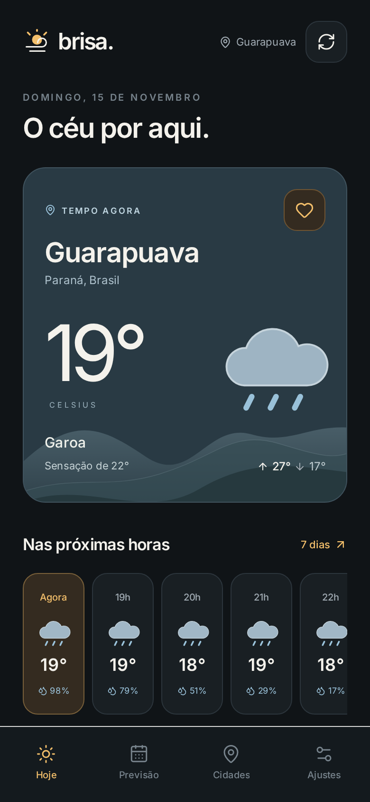
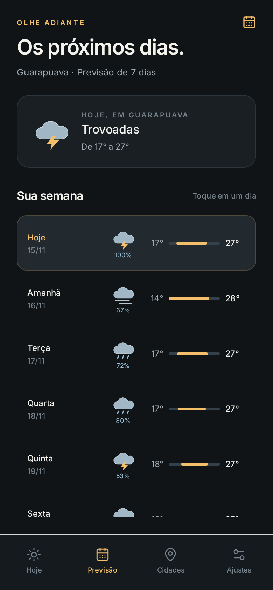
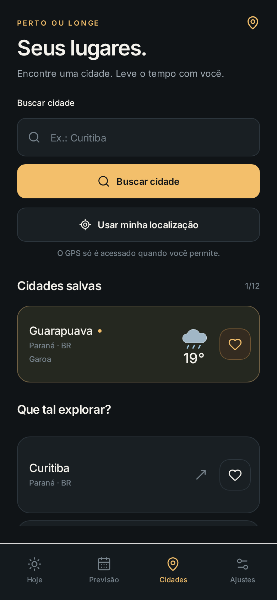
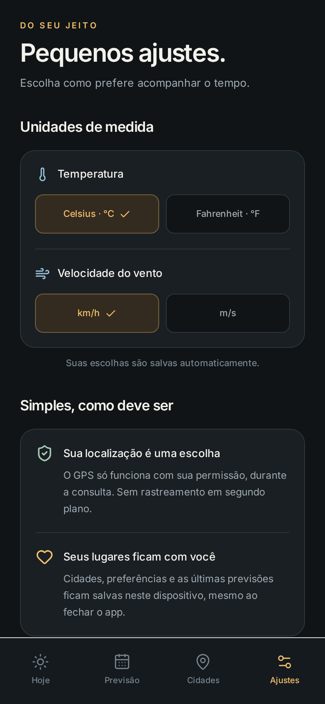

# Brisa

Um aplicativo de clima para acompanhar o tempo de hoje, planejar os próximos dias e guardar cidades favoritas.

**Aluno:** Guilherme Bueno Reis  
**Curso:** Engenharia de Software — Uniguairacá  
**Tecnologias:** React Native, Expo SDK 58 e TypeScript.

## Telas

| Tela | O que faz |
| --- | --- |
| Hoje | Mostra temperatura atual, sensação térmica, próximas 24 horas, chuva, vento, umidade, UV e horários do sol. |
| Previsão | Lista 7 dias. Ao tocar em um dia, mostra chuva prevista, vento máximo e horários do sol. |
| Cidades | Busca cidades pelo nome, valida a entrada, salva e remove favoritos e permite consultar a localização atual. |
| Ajustes | Altera Celsius/Fahrenheit e km/h/m/s, restaura as unidades padrão e apresenta informações sobre o aplicativo. |

## Como executar

### Requisitos

- Node.js 24 LTS, ou Node.js 22 a partir da versão 22.13.
- pnpm 11.25.0.
- [Expo Go compatível com o SDK 58](https://expo.dev/go) no celular, ou um emulador Android configurado.

### Instalação

```bash
corepack enable
corepack prepare pnpm@11.25.0 --activate
pnpm install --frozen-lockfile
pnpm start
```

Abra o projeto no Expo Go lendo o QR Code exibido no terminal. No Android, use o leitor do Expo Go; no iPhone, a câmera do sistema. Celular e computador devem estar na mesma rede.

Se a rede local ou o WSL impedir a conexão:

```bash
pnpm exec expo start --tunnel
```

O Expo poderá solicitar a instalação do suporte ao túnel. Para abrir em um emulador Android já iniciado, execute `pnpm android` ou pressione `a` no terminal do Expo. O simulador iOS exige macOS e Xcode.

Também é possível testar a versão web:

```bash
pnpm web
```

O aplicativo não exige cadastro, chave de API nem arquivo `.env`.

## Como usar

1. O app começa em Guarapuava, no Paraná.
2. Entre em **Cidades**, digite pelo menos duas letras e toque em **Buscar cidade**.
3. Toque no coração para salvar um resultado ou no nome da cidade para consultar o clima.
4. Em **Previsão**, toque em um dia para consultar seus detalhes abaixo da lista.
5. Em **Ajustes**, escolha as unidades. As alterações aparecem nas outras telas e continuam salvas ao fechar o app.
6. Para atualizar os dados, toque no botão de atualização da tela Hoje.

O botão **Usar minha localização** solicita acesso ao GPS apenas durante o uso. Negar a permissão mantém a busca manual disponível. Em navegadores, o GPS requer HTTPS ou localhost e a cidade é identificada como “Minha localização”.

## Prints das telas

Capturas reais da versão Expo Web em uma janela de 390 × 844, com dados consultados na Open-Meteo. A apresentação no Expo Go inclui as áreas de sistema do dispositivo.

| Hoje | Previsão |
| --- | --- |
|  |  |
| Cidades | Ajustes |
|  |  |

## Demonstração

[Assistir ao vídeo de demonstração](docs/brisa-demonstracao.mp4).

O vídeo apresenta a versão Expo Web em formato de celular, navegando pelas quatro telas, buscando uma cidade e alterando as unidades. Um roteiro para apresentar e explicar o código está em [docs/guia-apresentacao.md](docs/guia-apresentacao.md).

## Requisitos da atividade

| Requisito | Implementação |
| --- | --- |
| Expo e React Native | Projeto criado com `create-expo-app`; dependências nativas compatíveis com o Expo Go. |
| Quatro telas com navegação | `src/app/index.tsx`, `forecast.tsx`, `cities.tsx` e `settings.tsx`, com abas do Expo Router. |
| Componentes reutilizáveis | `Text`, `Button`, `IconButton`, `Screen`, `PageHeader`, `Notice`, `WeatherIcon`, cards e linhas de previsão. |
| Estado e efeitos | `useState` nas telas e no contexto; `useEffect` para leitura, persistência, carregamento e cancelamento. |
| Listagem | `FlatList` nas próximas horas, na previsão semanal e nas cidades. |
| Formulário validado | `TextInput` com validação de tamanho, espaços e presença de letras na busca. |
| Estilização | `StyleSheet.create`, paleta compartilhada e fonte Inter em todas as telas. |
| Versionamento e documentação | Histórico Git, README, prints, vídeo e instruções de execução. |
| Bônus: persistência | AsyncStorage para cidades favoritas, cidade selecionada, unidades e cache das últimas consultas. |
| Bônus: API pública | Previsão e busca de cidades da Open-Meteo, usando `fetch`. |
| Bônus: recurso nativo | Localização com `expo-location` e permissão durante o uso. |

## Organização

| Pasta | Responsabilidade |
| --- | --- |
| `src/app` | Telas e navegação. |
| `src/components` | Componentes visuais reutilizáveis e ilustrações em SVG. |
| `src/context` | Estado compartilhado, consultas, preferências e favoritos. |
| `src/models` | Tipos e validação dos dados. |
| `src/services` | Acesso à API e ao AsyncStorage. |
| `src/utils` | Conversões de unidades, datas, condições e validação da busca. |
| `tests` | Testes unitários de regras, API e armazenamento. |
| `e2e` | Testes de navegação e uso na versão web. |

## Testes e verificações

```bash
pnpm verify
pnpm exec expo install --check
pnpm dlx expo-doctor
pnpm export:web
pnpm exec playwright install chromium
pnpm test:e2e
pnpm exec expo export --platform android --platform ios --output-dir native-export
```

Os testes de interface verificam as mesmas funcionalidades em uma janela de celular e outra de desktop. As respostas da API são controladas nos testes para que eles não dependam do tempo real ou da disponibilidade do serviço. O app e as capturas usam a API pública.

O detalhamento dos resultados e dos limites da verificação está em [docs/verificacao.md](docs/verificacao.md). O fluxo do GitHub Actions repete as verificações ao receber commits.

## Dados e funcionamento sem conexão

As previsões e a busca de cidades vêm da [Open-Meteo](https://open-meteo.com/). A geocodificação utiliza dados do [GeoNames](https://www.geonames.org/). Os dados são disponibilizados sob [CC BY 4.0](https://creativecommons.org/licenses/by/4.0/).

As consultas usam as coordenadas da cidade escolhida ou da localização autorizada. O app não possui servidor próprio, autenticação ou rastreamento em segundo plano.

Após uma consulta bem-sucedida, o app pode exibir a previsão salva se a atualização falhar, identificando isso na tela. Novas buscas e atualizações exigem internet. O cache guarda até 20 previsões e a lista de favoritos permite até 12 cidades. Previsões com mais de 30 minutos recebem um aviso de atualização.

## Entrega

Antes de enviar ao Moodle, deixe o repositório **público**, abra seu link em uma janela anônima e confirme que o README, os prints e o vídeo estão acessíveis. A atividade solicita o link público do repositório.

Se estiver utilizando o pacote ZIP, veja [como publicar o projeto no GitHub](docs/publicacao-github.md).
